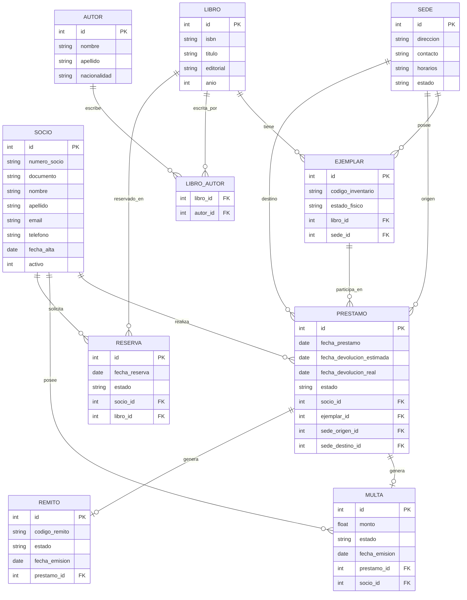

# Entidades y Relaciones

## 1. Entidades y Atributos

* **Sede**
    * `id` (PK)
    * `direccion`
    * `contacto`
    * `horarios`
    * `estado` (activo / baja)

* **Socio**
    * `id` (PK)
    * `numero_socio` (Único)
    * `documento` (Único)
    * `nombre`
    * `apellido`
    * `email`
    * `telefono`
    * `fecha_alta`
    * `activo` (1 = activo, 0 = inactivo/inhabilitado)

* **Autor**
    * `id` (PK)
    * `nombre`
    * `apellido`
    * `nacionalidad`

* **Libro** (Catálogo general)
    * `id` (PK)
    * `isbn` (Único)
    * `titulo`
    * `editorial`
    * `anio`

* **Ejemplar** (Unidades físicas distribuidas)
    * `id` (PK)
    * `codigo_inventario` (Opcional según requerimiento de códigos)
    * `estado_fisico` (Disponible, dañado, extraviado, etc.)
    * `libro_id` (FK hacia Libro)
    * `sede_id` (FK hacia Sede - indica la sede a la que pertenece físicamente)

* **Prestamo** (Préstamos locales e interbibliotecarios)
    * `id` (PK)
    * `fecha_prestamo`
    * `fecha_devolucion_estimada`
    * `fecha_devolucion_real`
    * `estado` (Activo, devuelto, vencido)
    * `socio_id` (FK hacia Socio)
    * `ejemplar_id` (FK hacia Ejemplar)
    * `sede_origen_id` (FK hacia Sede)
    * `sede_destino_id` (FK hacia Sede, en caso de préstamo interbibliotecario)

* **Multa** (Gestión de sanciones por retrasos)
    * `id` (PK)
    * `monto`
    * `estado` (Pendiente, pagada, condonada)
    * `fecha_emision`
    * `prestamo_id` (FK hacia Prestamo)
    * `socio_id` (FK hacia Socio)

* **Remito** (Trazabilidad logística del traslado)
    * `id` (PK)
    * `codigo_remito`
    * `estado` (Empaquetado, despachado, recibido, con incidencias)
    * `fecha_emision`
    * `prestamo_id` (FK hacia Prestamo)

* **Reserva**
    * `id` (PK)
    * `fecha_reserva`
    * `estado` (Pendiente, concretada, cancelada)
    * `socio_id` (FK hacia Socio)
    * `libro_id` o `ejemplar_id` (FK)

---

## 2. Relaciones y Cardinalidades

* **Autor (N) a (M) Libro**: Relación de muchos a muchos implementada a través de una tabla intermedia `libro_autor`.
* **Libro (1) a (N) Ejemplar**: Un libro del catálogo posee múltiples ejemplares físicos registrados.
* **Sede (1) a (N) Ejemplar**: Una sede aloja múltiples ejemplares físicos; cada ejemplar pertenece de manera estricta a una sede.
* **Socio (1) a (N) Prestamo**: Un socio puede registrar varios préstamos a lo largo del tiempo.
* **Ejemplar (1) a (N) Prestamo**: Un ejemplar físico participa en diversos préstamos históricos.
* **Sede (1) a (N) Prestamo (como Origen / Destino)**: Las sedes actúan como puntos de partida o recepción de los materiales solicitados.
* **Prestamo (1) a (0..1) Multa**: Un préstamo vencido puede generar una multa asociada.
* **Socio (1) a (N) Multa**: Un socio acumula multas por sus préstamos vencidos.
* **Prestamo (1) a (0..1) Remito**: Un préstamo interbibliotecario genera un remito para su trazabilidad logística en el trayecto.
* **Socio (1) a (N) Reserva**: Un socio puede gestionar reservas activas de material.

---

## 3. DER

