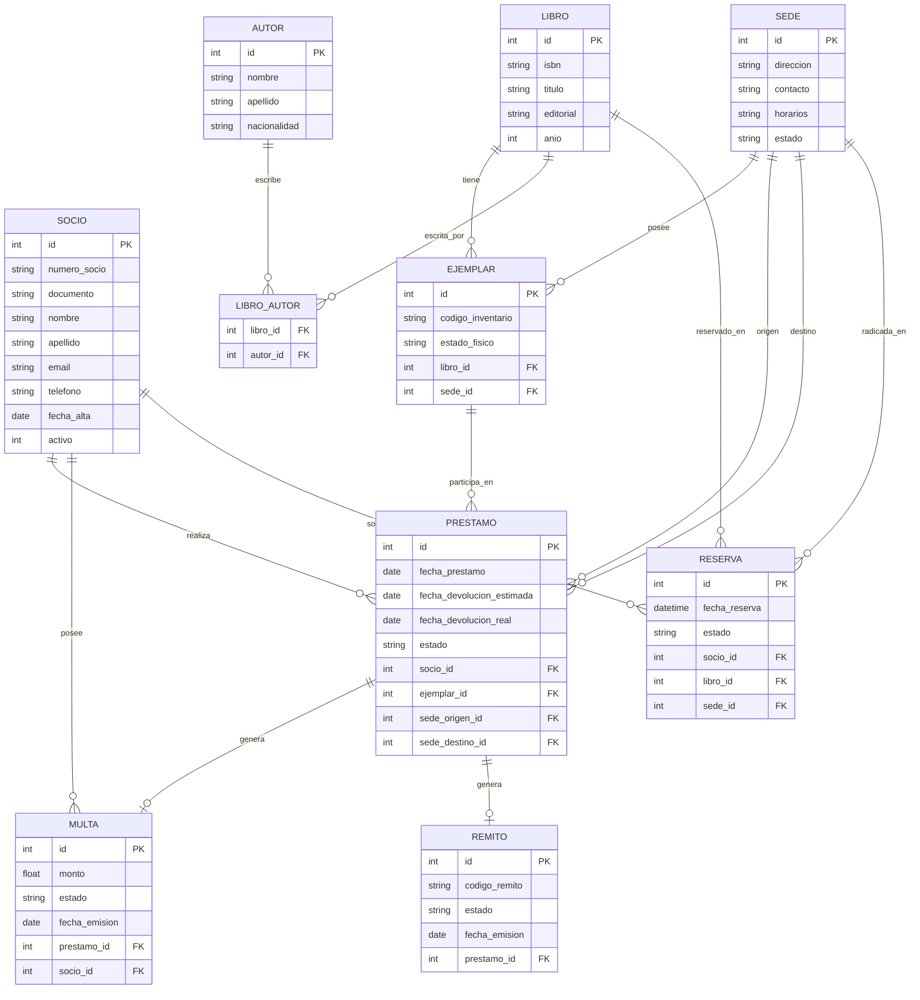
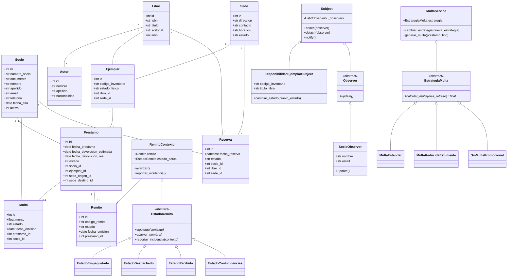

# Trabajo Práctico Integrador — Documento de Referencia de Desarrollo

---

## 1. Grupo

| Campo | Detalle |
|---|---|
| **Número de grupo:** | *(Completar número de grupo)* |
| **Tema:** | **Tema 1 — Biblioteca: Sistema de Préstamos Interbibliotecarios** |

### Integrantes

| Legajo | Nombre y Apellido |
|---|---|
| 400042 | Enzo Valentino Cardelli |
| *(Completar)* | Brisa Abigaíl Díaz |
| 87917 | Augusto Bossi |
| *(Completar)* | *(Integrante 4)* |

---

## 2. Propuesta

### 2.1. Objetivos del Sistema

#### Objetivo General
Desarrollar un sistema de escritorio orientado a objetos para la administración centralizada y logística de una **Red de Bibliotecas Públicas**, que permita gestionar múltiples sedes, el catálogo general de obras y sus ejemplares físicos distribuidos, el padrón de socios, los préstamos locales e interbibliotecarios con trazabilidad de remitos en tránsito, el control de reservas y la aplicación automatizada de multas y notificaciones.

#### Objetivos Específicos
1. **Centralizar el inventario bibliográfico multisede:** Registrar obras, autores (relación $N:M$) y ejemplares físicos identificando de forma unívoca su código de inventario, estado físico y sede de pertenencia.
2. **Garantizar la trazabilidad de préstamos interbibliotecarios:** Controlar el ciclo de vida completo de los traslados de ejemplares entre sedes mediante la emisión de remitos y la gestión de sus estados (`Empaquetado`, `Despachado`, `Recibido` y `Con incidencias`) aplicando el patrón de diseño **State**.
3. **Automatizar el control de vencimientos y sanciones:** Calcular multas por mora al momento de la devolución utilizando políticas tarifarias intercambiables mediante el patrón **Strategy**, aplicando además cargos automáticos por deterioro o extravío e inhabilitando preventivamente a los socios con deuda.
4. **Gestionar reservas y notificaciones desacopladas:** Permitir la reserva de obras sin stock disponible en una sede y notificar automáticamente a los socios en lista de espera cuando un ejemplar vuelve a estar disponible mediante el patrón **Observer**.
5. **Brindar información analítica para la toma de decisiones:** Proveer reportes no triviales en tiempo real sobre préstamos activos y en tránsito, morosidad acumulada, ranking de demanda inter-sedes y disponibilidad de catálogo por sucursal.

---

### 2.2. Alcances del Sistema

#### Procesos de Negocio Obligatorios Cubiertos
1. **Administración de Sedes:** Alta, baja lógica, modificación y consulta de sedes de la red (dirección, contacto, horarios y estado `activo` / `baja`).
2. **Administración de Socios:** ABMC completo de socios con control de unicidad (DNI y número de socio) y estado de habilitación (`activo` / `inhabilitado`).
3. **Administración de Catálogo y Ejemplares Físicos:** Gestión de libros (ISBN único), autores asociados y unidades físicas vinculadas a su sede de radicación.
4. **Registro de Solicitudes de Préstamo (Local e Interbibliotecario):** Validación preventiva de disponibilidad del ejemplar (RN-01), habilitación del socio (RN-02), pertenencia de sede en préstamos locales (RN-03), estado activo de sedes origen/destino (RN-04) y límite máximo de 3 préstamos activos simultáneos (SUP-04).
5. **Logística de Remitos (Empaquetar, Despachar y Recibir):** Emisión automática de remito en préstamos interbibliotecarios y trazabilidad de transiciones de estado mediante el patrón **State**, incluyendo reporte y resolución de incidencias en tránsito.
6. **Consulta de Disponibilidad:** Búsqueda y filtrado en vivo de ejemplares por sede, obra y estado físico.
7. **Gestión de Reservas:** Registro de reservas sobre obras con stock disponible igual a cero en la sede solicitada (SUP-06), cancelación manual y procesamiento de caducidad automática a las 48 horas (SUP-05).
8. **Registro de Devoluciones y Estado Físico:** Recepción del ejemplar (exigiendo remito `Recibido` en préstamos interbibliotecarios, SUP-03), actualización del estado físico (`Disponible`, `Dañado`, `Extraviado`), generación automática de multas por mora con el patrón **Strategy** (SUP-01) o cargos por daño/extravío (SUP-07), y disparo automático del patrón **Observer** cuando el ejemplar queda disponible.

#### Procesos Opcionales Incorporados
* **Envío de notificaciones automáticas (Patrón Observer):** Aviso automático a todos los socios con reserva pendiente cuando se devuelve un ejemplar en estado `Disponible`.
* **Inventario con códigos únicos:** Identificación individual de ejemplares (`codigo_inventario`) y remitos (`codigo_remito`).
* **Revisión de estado de recepción de ejemplares:** Control de devoluciones con daño o extravío y aplicación automática de cargo por reposición.

#### Reportes No Triviales Implementados
1. **Préstamos Activos y Material en Tránsito:** Cruce entre préstamos, ejemplares, libros, socios, sedes de origen/destino y estado logístico del remito.
2. **Préstamos Vencidos y Multas Acumuladas:** Detalle de préstamos con mora, cálculo de días de retraso, multas registradas/estimadas y causa.
3. **Libros Más Solicitados para Préstamos Inter-sedes:** Ranking agrupado por obra con conteo de solicitudes interbibliotecarias.
4. **Disponibilidad de Catálogo por Sede:** Totales de ejemplares por sucursal activa discriminando unidades disponibles y no disponibles.

---

### 2.3. DER y Diagrama de Clases UML

#### A. Diagrama Entidad-Relación (DER)

#### B. Diagrama de Clases UML (Modelo de Dominio y Patrones State, Strategy y Observer)

